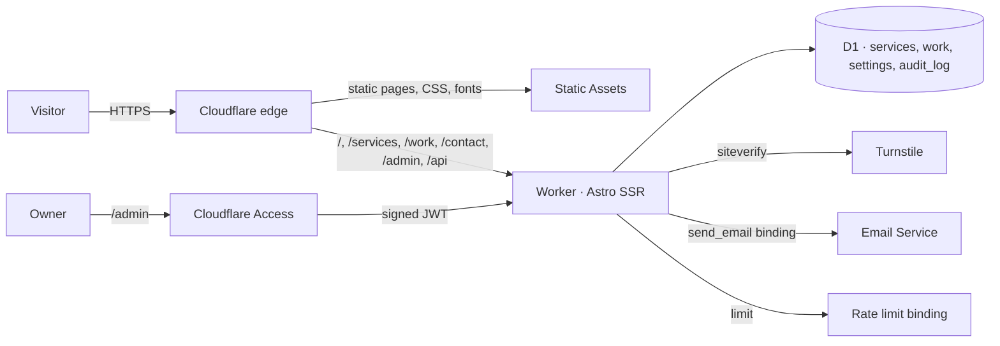

<p align="center">
  <a href="https://donsec.be"></a>
</p>

<h1 align="center">donsec.be</h1>

<p align="center">
  <strong>Built to work. Tested to break. Hosted to last.</strong><br>
  The website of <a href="https://donsec.be">DonIT&amp;Security</a> — custom software, security testing and AI engineering for Belgian SMEs.
</p>

<p align="center">
  <a href="https://donsec.be"></a>
  
  
  
  
  
</p>

---

This site is its own best sales pitch. DonIT sells serverless, privacy-first web applications with an owner-editable admin, and this repository is exactly that: a static-first Astro site on Cloudflare Workers, content in D1, an admin behind Cloudflare Access, a contact form that stores nothing, and a strict Content-Security-Policy with no inline scripts. No WordPress, no PHP, no paid hosting, no third-party scripts.

## Highlights

- **Serverless, global, free to run** — Cloudflare Workers + Static Assets. Pages that never change are prerendered; pages with editable content render on demand from D1 in a few milliseconds.
- **Own admin, live edits** — `/admin` edits services, prices, portfolio items and key site texts in English and Dutch. Saves are live immediately. Every save is audit-logged.
- **Zero cookies, zero trackers** — no analytics, no consent banner needed. Fonts are self-hosted. The only third-party host the CSP allows is Cloudflare Turnstile on the contact page.
- **Security by construction** — strict CSP without inline scripts or styles, HSTS preload, frame denial, minimal Permissions-Policy, COOP/CORP. Same header set on static and Worker responses.
- **Contact form that keeps nothing** — honeypot → native rate limit → Turnstile → validation → Cloudflare Email Service. The message is emailed and never stored.
- **Bilingual by path** — `/` is English, `/nl/…` is Dutch, with `hreflang` on every page and a language toggle that uses the URL only.
- **Content is data** — the initial content is Markdown in `seed/`; a script turns it into a D1 migration. After that, the database is the source of truth and the admin is the editor.

## Architecture



| Layer | Choice |
|---|---|
| Framework | [Astro 7](https://astro.build) with `@astrojs/cloudflare` — `output: 'static'`, dynamic routes opt in with `prerender = false` |
| Hosting | Cloudflare Workers + Static Assets, custom domains `donsec.be` and `www` (www 301s to the apex) |
| Content | Cloudflare D1 (`DB` binding): `services`, `work`, `settings`, `audit_log` |
| Admin | `/admin*` behind Cloudflare Access; the Worker verifies the Access JWT again with `jose` |
| Contact | Cloudflare Turnstile → `/api/contact` → `send_email` binding (Email Service), per-IP `ratelimits` binding |
| i18n | Path-based (`/` = en, `/nl` = nl), strings in `src/i18n/ui.ts`, fixed Dutch headline strings from the brand brief |
| Fonts | Inter 4 variable (weight + optical size), self-hosted from `/fonts` |
| Build | Node 22 locally or in Docker; GitHub Actions deploys `main` and uploads preview versions for PRs |

## Quick start

```bash
npm install
cp .dev.vars.example .dev.vars          # Turnstile test secret + admin bypass for local use
npm run build
npm run db:migrate:local                 # creates and seeds the local D1
npx wrangler dev --config dist/server/wrangler.json --persist-to "$PWD/.wrangler/state"
```

Open http://localhost:8787. The contact form uses Cloudflare's always-pass Turnstile test key locally, and the `send_email` binding writes outgoing mail to `dist/server/.wrangler/tmp/email/` instead of sending it. `/admin` is open locally because `.dev.vars` sets `ADMIN_DEV_BYPASS=true`; that file is never deployed.

Prefer not to install Node on the host?

```bash
docker compose run --rm build            # builds ./dist
docker compose up dev                    # Astro dev server on http://localhost:4321
```

## Editing content

**On the live site:** https://donsec.be/admin (Cloudflare Access login).

| What | Where |
|---|---|
| Service pillars — title, headline, summary, prices, CTA, body (Markdown), order | `/admin/services/<anchor>?lang=en\|nl` |
| Portfolio — name, one-liner, link, tags, pillar, NDA and home flags, order; add or delete | `/admin/work/<slug>`, `/admin/work/new` |
| Availability statement, hero subtitle, contact intro (EN + NL) | `/admin/settings` — empty field = built-in default |
| Privacy and terms | `src/content/legal/{en,nl}/*.md` (build time) |
| Everything else: navigation, principles, footer, form labels… | `src/i18n/ui.ts` (build time) |

Prices are entered one per line as `Label | 750` (a number means "from €750") or `Label | day rate on request` (free text). Leaving a pillar's home-card price empty shows "day rate on request" on the home page.

**Seeding.** `seed/services` and `seed/work` hold the original Markdown. `npm run db:seed` regenerates `migrations/0002_seed.sql` as `INSERT OR IGNORE`, so re-applying never overwrites edits made in the admin.

## Project layout

```
src/
  pages/              thin route files (EN at the root, NL under /nl), api/contact.ts, admin/*
  views/              one component per public page, takes `lang`
  components/         Header, Footer, PillarCard, WorkCard, ContactForm, PriceTable, Principles, …
  layouts/            Base.astro (head, SEO, hreflang, JSON-LD) and Admin.astro
  lib/content.ts      D1 queries + Markdown rendering
  lib/access.ts       Cloudflare Access JWT verification
  lib/security-headers.ts   single source for the header set (mirrored into public/_headers)
  i18n/               ui.ts (all strings), utils.ts
  scripts/            the only client JS: mobile nav toggle, contact form fetch
  middleware.ts       security headers, admin auth, CSRF check
seed/                 original content as Markdown → migrations/0002_seed.sql
migrations/           D1 schema and seed
public/               favicons, brand SVGs, fonts, _headers, robots.txt
```

## Security notes

- **CSP**: `default-src 'self'`; scripts and frames additionally allow `challenges.cloudflare.com` for Turnstile; no `unsafe-inline` anywhere. Astro is configured with `inlineStylesheets: 'never'`, and every client script is an external module.
- **Admin**: Access enforces the login at the edge, the Worker verifies the JWT (issuer, audience, signature) a second time, state-changing requests must be same-origin, responses are `no-store` and `noindex`. The workers.dev hostname is not behind Access and therefore returns 403 for `/admin`.
- **Contact API**: only the honeypot, rate limit, Turnstile verdict and validation decide; nothing is written anywhere. Responses carry the full security header set.
- **Transport**: HSTS with preload directive, Always Use HTTPS on the zone, TLS 1.3 enabled.

Targets: A+ on [securityheaders.com](https://securityheaders.com/?q=donsec.be&followRedirects=on) and [Mozilla Observatory](https://developer.mozilla.org/en-US/observatory/analyze?host=donsec.be).

## Deploy

Wrangler must be logged in to the Cloudflare account that owns `donsec.be`; `account_id` is pinned in `wrangler.jsonc` so a wrong login fails instead of deploying elsewhere.

```bash
npm run db:migrate:remote    # only when migrations/ changed
npm run deploy               # astro build && wrangler deploy
```

What the deployment relies on, all already configured:

| Resource | Notes |
|---|---|
| Worker `donsec-website` | custom domains `donsec.be`, `www.donsec.be`; preview URL on workers.dev |
| D1 `donsec-website` | schema + seed applied |
| Turnstile widget | site key in `.env` (`PUBLIC_TURNSTILE_SITE_KEY`), secret stored on the Worker as `TURNSTILE_SECRET_KEY` |
| Email Service | `donsec.be` onboarded for sending (records on `cf-bounce.donsec.be` + `_dmarc.donsec.be`) |
| Access app "donsec.be admin" | `donsec.be/admin*`; its AUD is in `wrangler.jsonc` |
| Zone | www → apex redirect rule, Always Use HTTPS |

**CI** (`.github/workflows/deploy.yml`): push to `main` applies migrations and deploys; pull requests upload a preview version. Needs repository secrets `CLOUDFLARE_API_TOKEN`, `CLOUDFLARE_ACCOUNT_ID` and the variable `PUBLIC_TURNSTILE_SITE_KEY`.

## Open items

Things the brand brief left to confirm, and how the build handles them today:

| Item | Current state |
|---|---|
| Pentest delivery framework naming | neutral wording: "delivered under a formal engagement framework with rules of engagement and insurance" |
| Retainer, workshop, assessment and pentest prices | "day rate on request" (editable in the admin) |
| Portfolio links and one-liners | editable in the admin; only `rysa.donsec.be` is linked so far |
| Photo and certifications on About | brand symbol instead of a photo; certifications section omitted |
| Dutch register | je/jij |
| Analytics | none |
| Booking tool | none, direct email only |
| General terms | draft, marked as such on the page |

**Accessibility note on the brand palette:** brand blue `#0A84FF` is 3.5:1 on white and fails WCAG AA for normal text. It is used for large headings, icons and accents only; links and buttons use `#0062C6` from the brand gradient (5.4:1).

---

<p align="center">
  <sub>DonIT&amp;Security · Eppegem, Belgium · BTW BE1021284326 · No cookies. No trackers. Built on Cloudflare Workers.</sub>
</p>
